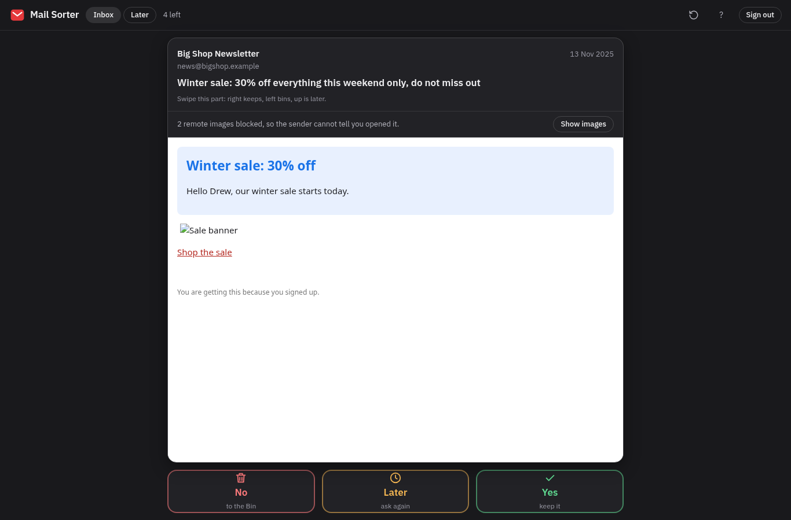

<div align="center">

# Mail Sorter

**Go through your Gmail inbox one email at a time: Yes keeps it, No moves it to the Bin, Later asks again after the rest. Sign in with Google, swipe on your phone or use the arrow keys on a laptop.**

[](https://www.python.org/)
[](https://flask.palletsprojects.com/)
[](https://developers.google.com/gmail/api)
[](LICENSE)

</div>



---

## Overview

Mail Sorter is a small self-hosted web app for clearing a Gmail inbox. After
you sign in with Google it shows the newest inbox email that you have not
sorted yet: the sender, subject, date, the email itself and the names of its
attachments. You make one of three choices and the next email appears.

| Choice | Button | Swipe (on the top part of the card) | Keys | What happens in Gmail |
|---|---|---|---|---|
| **Yes** | Yes, keep it | right | `→` or `Y` | stays in the inbox and gets the label `Sorted/Kept` |
| **No** | No, to the Bin | left | `←` or `N` | moved to the Bin (`messages.trash`); Gmail keeps it there for 30 days |
| **Later** | Later, ask again | up | `↑` or `L` | gets the label `Sorted/Later` and comes round again after the rest |

- **Undo** (the round arrow at the top, the Undo in the message that pops up,
  or `U` / `Ctrl+Z`) reverses the last choice: Yes takes the label off, No
  takes the email out of the Bin and back into the inbox, Later takes the
  label off. The undone email shows again straight away. Only the last
  choice can be undone, and the undo is remembered on the server, so it
  still works after a reload or from another device. Undo always names the
  email and choice it reverses: if another choice was made after it (say on
  your phone), it says so instead of reversing that other choice. Pressing
  Undo while the next email loads waits for it and then runs.
- **The counter** at the top shows how many emails are left and how many
  are waiting in Later.
- **Later** emails come round after every other email is sorted, in turn,
  each one going to the back again if you press Later again. The **Later**
  button at the top shows only those.
- **Images**: remote images are blocked until you press **Show images**
  (`I`), so a sender cannot tell that you opened the email. The bar says
  how many were blocked.
- **Progress lives in Gmail**: the two labels are the record of what you
  sorted. A reload, another browser, a phone and a laptop at once, or a
  restart of the app all carry on where you were.
- **Several people** can each sign in with their own Google account; each
  sees only their own mail.
- Works on a phone (one card filling the screen, big buttons at the bottom)
  and on a laptop (keys; `?` lists them).

Mail Sorter never deletes mail for good: it only ever calls Gmail's
`trash`, `untrash` and `modify` (labels), and the Google permission it asks
for, `gmail.modify`, does not allow permanent deletion.

---

## Google setup

Mail Sorter needs a Google Cloud OAuth client that belongs to you. Until
there is one, the site shows a **"Mail Sorter is not set up yet"** page and
nothing else breaks.

These steps were written from Google's documentation for the Google Cloud
console as it is in November 2026 (the "Google Auth Platform" pages); they
were not clicked through for this README. If a button has a slightly
different name, the page names below are the places to look.

1. **Project.** Open <https://console.cloud.google.com/> signed in as your own
   Google account. Click the project picker at the top left, then
   **New project**. Name it `Mail Sorter`, leave the location as it is, press
   **Create**, and when it is made, pick it in the project picker so it is
   the selected project for every step below.
2. **Turn on the Gmail API.** Open
   <https://console.cloud.google.com/apis/library/gmail.googleapis.com> (check
   the project picker shows `Mail Sorter`) and press **Enable**.
3. **Consent screen.** Open <https://console.cloud.google.com/auth/overview>
   and press **Get started**.
   - **App information**: App name `Mail Sorter`, User support email: your
     own address. **Next**.
   - **Audience**: **External**. **Next**.
   - **Contact information**: your own address. **Next**.
   - Tick that you agree to the Google API Services User Data Policy, press
     **Continue**, then **Create**.
4. **Testing mode and test users.** Open
   <https://console.cloud.google.com/auth/audience>. **Publishing status**
   should say **Testing**; leave it like that. Under **Test users** press
   **Add users**, type your Gmail address (and the address of anyone else
   who will use Mail Sorter, up to 100), and press **Save**. In Testing mode
   only these people can sign in.
5. **Permission (scope).** Open
   <https://console.cloud.google.com/auth/scopes>, press **Add or remove
   scopes**, and in **Manually add scopes** paste
   `https://www.googleapis.com/auth/gmail.modify`, press **Add to table**,
   then **Update**, then **Save** at the bottom of the page. Add nothing else:
   Mail Sorter asks for this one permission only.
6. **Authorised domain.** Open <https://console.cloud.google.com/auth/branding>,
   under **Authorised domains** press **Add domain**, type your own domain
   (for `mail.example.com` that is `example.com`) and
   press **Save** (skip this if it is already listed).
7. **OAuth client.** Open <https://console.cloud.google.com/auth/clients> and
   press **Create client**.
   - **Application type**: **Web application**.
   - **Name**: `Mail Sorter`.
   - **Authorised JavaScript origins**: leave empty.
   - **Authorised redirect URIs**: press **Add URI** and enter exactly
     `https://mail.example.com/auth/callback` (your own `SITE_HOST`)
     (https, no slash at the end). To also run it on your own machine, add
     `http://localhost:8101/auth/callback` as a second one.
   - Press **Create**. The dialog shows the **Client ID** (ends in
     `.apps.googleusercontent.com`) and the **Client secret** (starts with
     `GOCSPX-`). Google shows the secret in full only now, so press
     **Download JSON** as well and keep that file somewhere private (not in
     this repo).
8. **Put the client on the server.** On the laptop:

   ```bash
   cd MailSorter
   ./deploy.sh google
   ```

   Paste the Client ID, press Enter, paste the Client secret (it is not
   shown while you type), press Enter. The script checks that both look
   right, writes them into `/etc/mail-sorter/mail-sorter.env` in the container (it
   keeps the earlier file beside it as `mail-sorter.env.before-google-<time>`),
   restarts the app and prints its health, which should now say
   `"googleReady":true`. The id and secret travel over ssh on standard input,
   so they never appear on a command line or in a log. To do it by hand
   instead: ssh to the Proxmox host, `pct enter <CT>`, `nano /etc/mail-sorter/mail-sorter.env`,
   fill in `GOOGLE_CLIENT_ID=` and `GOOGLE_CLIENT_SECRET=`, then
   `systemctl restart mail-sorter`.
9. **Sign in.** Open `https://SITE_HOST` and press **Sign in with
   Google**. Pick your account. Google shows **"Google hasn't verified this
   app"** because the app is yours and in Testing mode: press **Continue**.
   On the permission screen make sure the Gmail box is ticked and press
   **Continue**. You land on your first email.

**The 7-day sign-in limit in Testing mode.** While the app is in Testing
mode, Google ends the sign-in (the refresh token) 7 days after you sign in.
Mail Sorter notices on the next request, removes the dead token and shows
the sign-in page with "Your Google sign-in ran out or was taken back". Sign
in again; nothing is lost, because your progress is in the Gmail labels.
What you can do about it:

- **Simplest:** just sign in again when it asks, about once a week.
- **Longer sessions:** on <https://console.cloud.google.com/auth/audience>
  press **Publish app** to move it to **In production**.
  **Warning: set `ALLOWED_ACCOUNTS` before you publish.** In Testing mode
  only the test users can sign in; once published, *any* Google account can
  sign in to your Mail Sorter unless `ALLOWED_ACCOUNTS` lists who may.
  According to
  Google's documentation, refresh tokens then stop expiring after 7 days;
  but `gmail.modify` is a *restricted* scope, so without Google's full
  verification (which includes a paid security assessment) the app stays
  "unverified": everyone sees the warning screen at sign-in and at most 100
  people can ever use it. For one person that is workable. This was not
  tried for this README.

**Taking access back.** **Sign out** in Mail Sorter revokes the token at
Google and deletes it from the server. If Google cannot be reached at that
moment, the page says so (the token is still deleted from the server) and
points you to the page below. You can also remove Mail Sorter at
<https://myaccount.google.com/connections>; Mail Sorter then shows the
sign-in page on your next action.

---

## Requirements

- Python 3.11+
- Outbound HTTPS to `accounts.google.com`, `oauth2.googleapis.com` and
  `gmail.googleapis.com`.

---

## Install and run on your own machine

```bash
git clone <this repo> mail-sorter
cd mail-sorter
python3 -m venv .venv
.venv/bin/pip install -r requirements.txt
cp .env.example .env
.venv/bin/python -m mailsorter
```

Then open `http://localhost:8101`. With the empty client in `.env.example`
it shows the "not set up yet" page. To sign in locally, add
`http://localhost:8101/auth/callback` to the OAuth client's redirect URIs
(step 7) and fill in `GOOGLE_CLIENT_ID` and `GOOGLE_CLIENT_SECRET` in `.env`.
Google only accepts plain `http` redirects for `localhost`, so open it as
`localhost`, not `127.0.0.1`, to match `PUBLIC_URL`.

---

## Configuration (`.env` or environment)

| Key | Description |
|---|---|
| `PUBLIC_URL` | The address people open, scheme and host only. Builds the redirect URI (`PUBLIC_URL/auth/callback`) and the allowed `Origin` for writes. Must be `https://` unless the host is `localhost` or a loopback address; anything else stops the app at start-up. Default `http://127.0.0.1:8101`. |
| `BIND_HOST` / `PORT` | Where the app listens. Default `127.0.0.1:8101`. |
| `DATA_DIR` | The database (`mail-sorter.db`) and the CSRF secret (`secret_key`). Default `./data`. |
| `GOOGLE_CLIENT_ID` / `GOOGLE_CLIENT_SECRET` | The OAuth client from the Google setup. Empty or malformed values do not stop the app: it shows the "not set up yet" page saying which one is wrong. |
| `TOKEN_KEY_FILE` | The key that encrypts Google tokens in the database. Default `DATA_DIR/token.key`, made on first start (mode 600). On the server it is `/etc/mail-sorter/token.key`, made by `deploy.sh`, so a copy of the data folder alone does not reveal tokens. Losing or changing the key signs everyone out (they just sign in again). |
| `ALLOWED_ACCOUNTS` | Optional comma separated Gmail addresses. When set, anyone else is refused after Google sign-in and their token is revoked straight away, every request is checked against it, and at start-up the tokens and sessions of accounts no longer listed are deleted. In Testing mode Google's test user list already limits who can sign in. Set it before pressing **Publish app**. |
| `SECRET_KEY` | Optional. Without it a random key is made once in `DATA_DIR/secret_key`. Shorter than 32 bytes stops the app. |
| `TRUSTED_PROXIES` | Optional comma separated addresses or networks of the proxy in front, such as `127.0.0.1,::1` for Caddy on the same host. Only requests from these carry a believed `CF-Connecting-IP` for the sign-in limit; without it every request counts as the address it came from. A network with host bits set, or one that reaches public addresses, stops the app at start-up. |

---

## How it works

**Sign-in.** OAuth 2.0 authorization code flow on the server, with PKCE
(S256) and a `state` value. `/auth/google` makes a random state and PKCE
verifier and seals both into an `HttpOnly` cookie that is encrypted and
signed (Fernet, with a key derived from the app's secret) and stops working
after 10 minutes, so nothing is stored on the server for a sign-in under way
and nobody can push other people's sign-ins out. It sends you to Google
asking for `gmail.modify` only, with `access_type=offline` and
`prompt=consent` so Google always returns a refresh token.
`/auth/callback` accepts the answer only when the `state` in the address
equals the one sealed in the cookie; then it trades the code (with the
verifier) for tokens, checks that the Gmail permission was really granted
(Google lets people untick it; the grant is revoked and refused if so),
reads the account's address from Gmail's `users.getProfile`, and starts a
session. Signing in again revokes the earlier refresh token at Google; if
that also ends the new one, the page asks you to sign in once more. Every
`/auth/` path allows 30 requests a minute per address (the visitor's
address from Cloudflare's `CF-Connecting-IP`, believed only when the request
came from a proxy listed in `TRUSTED_PROXIES`; the shipped Caddy block removes
that header unless the request came from the tunnel at `TUNNEL_PEER`).

**Tokens and sessions.** Access and refresh tokens are encrypted with
Fernet (`cryptography`) before they are written to SQLite. Access tokens are
renewed a minute before they run out, and again if Gmail answers 401 in the
middle of a session. Requests for one account are handled one at a time,
so two that both find the token out of date share one renewal. When
Google refuses the refresh token (Testing mode's 7 days, or access taken
back), the account's tokens and sessions are deleted and the page asks you
to sign in, unless the account signed in again in the meantime, in which
case the new sign-in is used. The session cookie is random, `HttpOnly`,
`SameSite=Lax`, lasts 30 days, and is stored on the server only as a hash.
On https both cookies are named with the `__Host-` prefix (`Secure`,
`Path=/`, no `Domain`), so another site on the same domain cannot plant them, and
every answer carries `Strict-Transport-Security`. On plain
`http://localhost` they keep their plain names so local testing works. **Sign out** revokes the refresh token at Google, then deletes the
tokens and every session of that account (phone and laptop both).

**The queue.** Mail Sorter lists message ids with the label `INBOX`,
`Sorted/Kept` and `Sorted/Later` (Gmail's `labelIds` filter, 500 per page,
up to 10,000 of each) and works out: to sort = inbox minus kept minus later,
newest first; later = inbox emails with the Later label. The lists are
reread every 60 seconds. Before an email is shown it is fetched again and
its labels checked, so an email that was deleted, archived, binned or sorted
somewhere else (Gmail itself, another device) is skipped quietly. The
labels are made the first time they are needed, or reused if they exist.

**Edge cases handled (each has a test):**

- Gmail rate limits (`429`, or `403` with `rateLimitExceeded` /
  `userRateLimitExceeded`) and `500`/`502`/`503`/`504` are retried up to 4
  times with waits of 1, 2 and 4 seconds (or Google's `Retry-After`, at most
  8 seconds). If Gmail is still busy the page says "Gmail is busy right now"
  with **Try again**, and nothing changed.
- An empty inbox shows **All sorted**, with a button to go through Later if
  anything waits there.
- A token that runs out mid-session is renewed and the request repeated.
- An email deleted elsewhere is skipped; choosing on one answers "That
  email was moved or deleted somewhere else" and moves on.
- A double tap: the buttons are disabled while a choice is on its way, and
  the server also ignores the same choice on the same email repeated within
  5 seconds, including two taps arriving at the same moment.
- A label deleted in Gmail while you sort is made again.
- Google not reachable answers "Could not reach Google" with **Try again**.
- An email that cannot be read (a broken encoded subject, a strange or
  hostile charset, text that will not decode) still gets a card that can be
  sorted; charsets that are not text encodings (`hex`, `base64`, `rot13`,
  `zlib`, `bz2`, `uu`, `quopri`, `idna`, `undefined`, `unicode_escape`,
  `raw_unicode_escape`, `utf-7`) are read as UTF-8 instead.
- An email whose HTML is over 1 MB or nested more than 200 levels deep, or
  that takes the cleaner more than 1.5 seconds, is shown as its plain-text
  part, or as "too complex to show here" when it has none; it can still be
  sorted. The cleaned body is kept for the last few emails, so each is
  cleaned once.
- A Gmail answer over 6 MB is not read whole: the email is shown by its
  From, To and Subject with "too large to show here".

**Showing email safely.** Emails are untrusted. The body is cleaned on the
server with `nh3` (allowed tags and attributes only; no scripts, event
handlers, forms, frames, `javascript:` or non-image `data:` links; `<style>`
blocks are dropped with their content and only `style` attributes with an
allowed list of properties stay, CSS positioning dropped). The cleaning runs
in two separate worker processes with a hard time limit, so one hostile
email cannot hold up the app. The email is then shown in an
`<iframe sandbox>` with no scripts and no same-origin access, from an
address that sends its own Content-Security-Policy: `default-src 'none'`,
`img-src data:` (remote images blocked), `font-src 'none'`,
`style-src 'unsafe-inline'` (for those `style` attributes),
`form-action 'none'`, and the CSP `sandbox` directive too, so the email
stays boxed in even if opened directly. The frame is hidden and the choices
are off until the email's own body has loaded, so an old body never shows
under a new header. **Show
images** reloads it with `img-src data: https:`. Links open in a new tab
without a referrer. Plain-text emails are escaped and only their web links
are made clickable. Sender, subject and attachment names are put on the page
as text, never as HTML. The app's own pages have a strict CSP (scripts,
styles and fonts from itself only, frames only from itself) and
`X-Frame-Options: DENY`.

**Writes** (the choices, undo and sign-out) need the `X-CSRF-Token` from
`/api/session` (an HMAC of the session) and are refused when their `Origin`
is not `PUBLIC_URL`.

**Known limits.** Inline `cid:` images inside an email are not shown. A
body part over 2 MB, or a Gmail answer over 6 MB, shows "too large to show
here". HTML over 1 MB or nested more than 200 levels deep is shown as plain
text. The count stops at
10,000 per label and then shows `+`. Plain `http://` images stay blocked
even after **Show images**, because the site is https. Only the last choice
can be undone.

---

## Deploy

`deploy.sh` installs Mail Sorter into a Proxmox container that already runs
Caddy, reached with `ssh` and `pct`. The values for your own setup live in
`deploy/site.env`, which git ignores. Copy `deploy/site.env.example` and
fill it in:

| Key | Description |
|---|---|
| `PROXMOX` | The ssh host name of the Proxmox machine. |
| `CT` | The number of the container that runs Caddy. |
| `SITE_HOST` | The host name Mail Sorter is served on, like `mail.example.com`; `PUBLIC_URL` becomes `https://SITE_HOST` on a first install. |
| `TUNNEL_PEER` | The address the Cloudflare tunnel (cloudflared) reaches Caddy from. The Caddy block removes `CF-Connecting-IP` from every other request. |

What it sets up, next to the other apps behind the same Caddy:

| Piece | Where |
|---|---|
| Code and venv | `/opt/mail-sorter` (root owned) |
| Data | `/var/lib/mail-sorter` (user `mail-sorter`, mode 700) |
| Settings | `/etc/mail-sorter/mail-sorter.env` (root:mail-sorter 640), from `deploy/mail-sorter.env`, Google client empty; an older file without `TRUSTED_PROXIES` gets that line added by `apply` |
| Token key | `/etc/mail-sorter/token.key` (root:mail-sorter 640), made once by `apply` |
| Service | `mail-sorter.service` from `deploy/mail-sorter.service`, on `127.0.0.1` at `PORT` (8101, the next after 8097 to 8100), sandboxed, `MemoryMax=256M` |
| Caddy | the `http://SITE_HOST` block from `deploy/Caddyfile.mail-sorter`, between `# >>> mail-sorter block, ...` and `# <<< mail-sorter block`, with the port and the host filled in |
| Tunnel | a public hostname for `SITE_HOST` on the Cloudflare tunnel to port 80 of the Caddy container |

Unlike Tasks, Keep Notes and Read Later the Caddy block has **no starfire sign-in
in front**: Google sign-in is the gate, so several Google accounts can use
it. Until the Google client is in place, the public page is the "not set up
yet" page and every `/api/` path answers `503`.

From your own machine:

```bash
./deploy.sh backup          # Caddyfile, any earlier install and a copy of the database into /root in the container
./deploy.sh apply           # install HEAD, start the service, add the Caddy block, then check
./deploy.sh check           # read the "check failures:" line, 0 is good
./deploy.sh google          # paste the Google client id and secret (see Google setup)
./deploy.sh undo            # put back what the last apply changed
```

`apply` refuses to run before `backup`, refuses while another `deploy.sh`
runs on the laptop, and refuses if another program listens on the port.
Caddy is shared with other apps, so before changing the Caddyfile the CT
side waits (up to 15 minutes) until no other app's deploy script runs in
the container, the Caddyfile has not changed for 5 minutes, and it can create
`/root/caddy-edit.lock` with noclobber; it removes the lock when done and
never touches a lock someone else holds. The Caddyfile is checked with
`caddy validate` before every reload and put back if that or the reload
fails. Every deployed file's sha256 is compared with the commit. `undo`
puts back the earlier code (or, after a first install, stops and removes
the service) and only the mail-sorter block in the Caddyfile; the env file,
the token key and `/var/lib/mail-sorter` are never touched. Each `apply`
and `undo` keeps the three newest earlier and undone code copies and
Caddyfile copies. `backup` keeps the three newest
`/root/mail-sorter-before-*.tgz` backups (they hold the env file and the
token key) and `google` keeps the three newest
`mail-sorter.env.before-google-*` copies; older ones are deleted.

**Backup of the database** (it holds only encrypted tokens, sessions and
the last choice; your mail state is in Gmail): `./deploy.sh backup` makes a
consistent copy with SQLite's online backup, run as the service user.

---

## API

Every path except `/`, `/static/*`, `/auth/google`, `/auth/callback` and
`/api/health` needs a signed-in session cookie; writes also need
`X-CSRF-Token`.

| Method | Path | Purpose |
|---|---|---|
| GET | `/api/health` | `{"ok": true, "googleReady": true}`; `503` when the database cannot be read |
| GET | `/api/session` | `{"account", "csrfToken", "version", "lastChoice": {"id", "action"} or null}` |
| GET | `/api/next?view=inbox\|later` | `{"message": {...} or null, "counts": {"left", "later", "more"}}` |
| GET | `/api/counts` | `{"left", "later", "more"}` |
| GET | `/api/messages/<id>/body[?images=1]` | the cleaned email as its own sandboxed page |
| POST | `/api/messages/<id>/yes\|no\|later` | the choice; `{"repeated": false}` (or `true` for a double tap) |
| POST | `/api/undo` | JSON `{"id", "action"}` naming the choice to reverse; answers `{"undone": "yes\|no\|later", "id"}`, `400` without them, `409` when there is nothing to undo or (`"stale": true`) another choice came after it |
| POST | `/auth/signout` | `{"signedOut": true, "revoked": true\|false}`; the page then says whether Google took the access back |

A message is `{"id", "from": {"name", "address"}, "to", "subject", "date"
(milliseconds), "snippet", "attachments": [{"name", "type", "size"}],
"isLater", "remoteImages"}`, plus `"unreadable": true` when the email could
not be read and a plain card is shown. Errors answer `{"error": "..."}` with
`400`, `401` (`"signIn": true`), `403`, `404`, `409`, `410` (`"gone": true`),
`429` (too many `/auth/` requests), `502` or `503` (`"retry": true` when trying again can help, `"notSetUp": true`
before the Google setup).

---

## Tests

```bash
.venv/bin/pip install -r requirements-dev.txt
.venv/bin/python -m pytest -q
```

The tests run the real app against `tests/fake_google.py`: a fake Google
OAuth server (authorize, token with PKCE checks, refresh, revoke) and a
fake Gmail API with mailboxes, labels, trash and injected failures, served
over real HTTP. `tests/test_deploy.py` runs the server half of `deploy.sh`
against a scratch folder with `systemctl`, `caddy`, `curl` and friends
stubbed out.

---

## Tech

- Flask served by waitress, SQLite in WAL mode.
- The Gmail API and Google OAuth over the standard library's `urllib`; no
  Google client library.
- `nh3` to clean email HTML, `cryptography` (Fernet) for tokens at rest.
- Plain HTML, CSS and JavaScript: no build step. The look and the colour
  tokens come from starfire, with the IBM Plex fonts bundled.

## License

MIT - made by Drew. The IBM Plex fonts are under the SIL Open Font License
(`mailsorter/static/fonts/LICENSE-ibm-plex.txt`).
